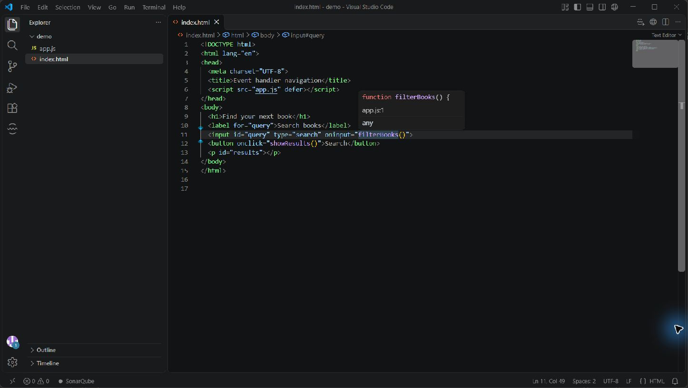
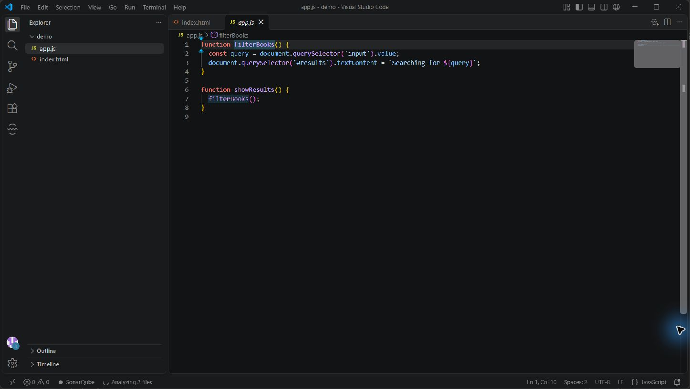

# HTML Event Handler Navigation

Navigate from JavaScript function calls in HTML event attributes such as `onclick`, `oninput`, `onchange`, and `onload`.

Place the cursor on a function name and press **F12** (or Ctrl+click) to go to its definition. Hover over the name to see a declaration preview and its location. Multiple matching definitions are offered when applicable. Unsaved changes in open HTML and JavaScript files are included.

To reuse a JavaScript file that's already open in another editor group, add this VS Code setting to your `settings.json`:

```json
"workbench.editor.revealIfOpen": true
```

This is a VS Code-wide setting and affects editor navigation beyond this extension.

The extension looks in classic inline `<script>` blocks and local JavaScript files referenced by `<script src="...">` in the same HTML document. It recognizes top-level function declarations, variables initialized with functions or arrow functions, and functions assigned to `window` or `globalThis`. Calls to `window.name()` and `globalThis.name()` are also supported.

It does not execute scripts or follow dynamically loaded scripts, remote URLs, or module imports. Module-local declarations are not globals and are excluded. Complex object methods, HTML character references inside event-handler code, framework templates, and server-generated script paths are not currently resolved. Root-relative paths are resolved as file URLs, so use relative paths for local workspace files.

## See it in action

Hover over a handler to see its declaration:



Use Go to Definition to open the linked JavaScript function:



## Development

Run `npm install` and `npm test`, then open this folder in VS Code and press F5 to launch an Extension Development Host. Run `npm run package` to produce a VSIX for installation with **Extensions: Install from VSIX...**.


## Icon attribution

The icon incorporates the [W3C HTML5 logo](https://www.w3.org/html/logo/), licensed under [CC BY 3.0](https://creativecommons.org/licenses/by/3.0/). The original shield is resized and combined with a JavaScript-inspired tile and arrow.
